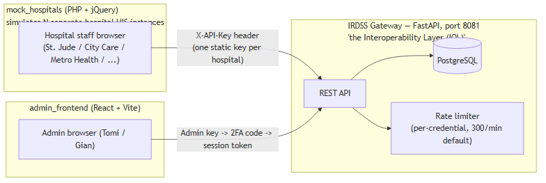
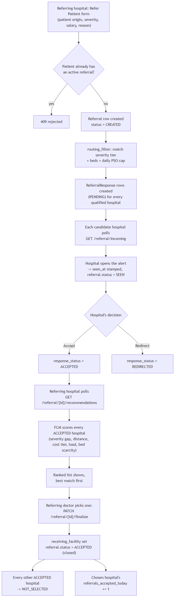

# IRDSS — How the Actual System Works

This describes the system **as built**, not the original 3-year proposal in
`system_flow.md` (that doc is the academic spec — PSO optimizer, generic RBAC,
etc. — most of which was never built or was replaced with something simpler).
Keep both: this one for "how does the code actually behave," the other for
"what was originally proposed."

---

## 1. The three pieces, and how they talk to each other

- **mock_hospitals** is not one hospital — it's a stand-in for *every* hospital's own HIS. Each hospital "logs in" with its own username/password (its own local MySQL `hospitals` table), and its own PHP session holds its own hospital identity. PHP proxies (`referral_api.php`, `inventory_api.php`, `send_referral.php`) forward requests to the gateway using that hospital's *own* API key, resolved fresh from the DB on every request (not cached in the browser).
- **The gateway** is the single source of truth: one PostgreSQL database, one FastAPI process, no per-hospital databases. Every hospital and the admin panel hit the exact same API, just with different credentials and different route access.
- **admin_frontend** is a separate, unrelated React app for network operators (not hospital staff) — hospital management, API key issuance, live traffic/log monitoring.

---

## 2. Definitions

| Term | Meaning |
|---|---|
| **Referral** | One row in `referrals` — one patient, one referring hospital, one clinical episode. Created once via `/referral/initiate`, closed once via `/referral/finalize` or `/referral/cancel`. |
| **ReferralResponse** | One row per *candidate* hospital that was broadcast a given referral. A single referral has many of these (one per qualified hospital), each with its own independent status. |
| **patient_code** | SHA-256 hash of (given name + family name + birthdate + sex). Never the patient's real name — lets the gateway detect "is this same patient already referred elsewhere" without storing identity. |
| **matching_degree** | A 0–1 fuzzy score (FCM — Fuzzy C-Means membership) ranking each *accepting* hospital's suitability for this patient. Computed only across hospitals that said ACCEPTED, not the whole candidate pool. |
| **PSO daily routing limit** | Each hospital has `pso_daily_routing_limit` (default 5) and a `referrals_accepted_today` counter. Once the counter reaches the limit, that hospital stops being offered new referrals for the rest of the day. |
| **Admin account** | A named person (e.g. Tomi, Gian) with their own API key + their own TOTP secret — separate table from hospital keys, so a hospital's key can never pass as an admin credential. |

---

## 3. Referral lifecycle — the rules

**Rule 1 — one active referral per patient, network-wide.**
Before creating a referral, the gateway checks every existing referral with the same `patient_code` that hasn't been finalized (`receiving_facility IS NULL`). If any of those still has at least one non-REDIRECTED response outstanding, the new submission is rejected (`409`). This is the "already has an active referral" error you saw earlier.

**Rule 2 — who gets broadcast the referral is decided by clinical tier, not by choice.**
`routing_filter.get_qualified_broadcast_targets()` filters candidate hospitals by:
- `available_beds > 0`
- `referrals_accepted_today < pso_daily_routing_limit`
- Severity ≥ 3 (severe) → must be **Level 3** with `emergency_equipment`
- Severity = 2 (moderate) → must be **Level 2 or 3** with `medical_equipment`
- Severity ≤ 1 (mild) → any level, just needs `communication_systems`

Every hospital that passes gets a `ReferralResponse` row with `PENDING` status. The referring hospital itself is excluded.

**Rule 3 — each candidate hospital decides independently.**
A hospital can `ACCEPT` or `REDIRECT` (`PATCH /respond`). This only updates *that hospital's own* response row — it has no effect on any other hospital's pending row. Multiple hospitals can accept the same referral simultaneously; nothing is decided yet.

**Rule 4 — ranking only happens among hospitals that actually accepted.**
`GET /recommendations` collects every `ACCEPTED` response for a referral, runs `compute_compatibility_scores()` (FCM) across just that pool, and returns them sorted best-first. Rejected/redirected/pending hospitals never enter this ranking.

**Rule 5 — finalizing is the only thing that actually "spends" hospital capacity.**
`PATCH /finalize {hospital_name}` requires that hospital to currently be `ACCEPTED`. On success:
- `referrals.receiving_facility` is set, `referrals.status = ACCEPTED` (closed).
- Every *other* `ACCEPTED` hospital flips to `NOT_SELECTED`.
- Only the **chosen** hospital's `referrals_accepted_today` increments — accepting doesn't cost anything; being *picked* does. This is deliberate: several hospitals can say yes without prematurely burning their daily quota.

**Rule 6 — cancellation only works before anyone has accepted.**
The referring hospital can `PATCH /cancel` at any time *unless* at least one hospital has already `ACCEPTED`. Cancelling flips the referral to `CANCELLED` and clears out any still-`PENDING` rows so they stop showing up in other hospitals' inboxes.

---

## 4. The full flow, end to end

---

## 5. Status reference

**`referrals.status`** — the referral as a whole:
`CREATED` → `SEEN` (first hospital opened it) → `ACCEPTED` (finalized) *or* `CANCELLED` (referring hospital pulled it before anyone accepted).

**`referral_responses.response_status`** — one per candidate hospital:
`PENDING` → `ACCEPTED` / `REDIRECTED` / `CANCELLED` (broadcast pulled) → `NOT_SELECTED` (was accepted, but a different hospital got finalized instead).

---

## 6. Authentication model

Two entirely separate credential spaces, on purpose (a hospital key can never pass as an admin key, and vice versa):

- **Hospitals** — one static `X-API-Key` per hospital, SHA-256 hashed at rest in `api_keys`. Validated on every request; no session, no expiry, rotated only when an admin does it manually.
- **Admins** — named accounts in a separate `admins` table, each with their own key *and* their own TOTP secret (Google Authenticator). Login is two phases: raw key first, then a 6-digit code, which exchanges for a short-lived signed session token used for every subsequent request. An environment root key exists as a break-glass fallback and skips 2FA entirely.
- **Rate limiting** applies gateway-wide, keyed by a hash of the caller's API key (not IP — every hospital proxies through the same PHP server, so IP alone can't tell them apart). Admin login/2FA endpoints have a tighter cap specifically to blunt credential/OTP guessing.

---

## 7. What's *not* actually in the running system

For contrast with the original proposal doc: there is no PSO (Particle Swarm
Optimization) script — "PSO daily routing limit" survives only as a simple
per-hospital daily counter/cap, not an optimization algorithm. There's no
generic JWT/RBAC layer for hospitals — hospital auth is a flat static API key.
FHIR/PHeReF compliance is partial (the referral payload shape borrows FHIR's
`Encounter`/`Patient` structure, but it's not validated against the full IG).
